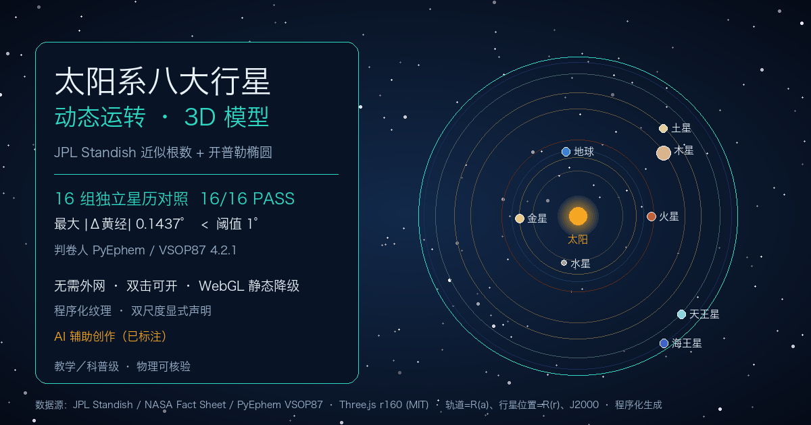

# 太阳系八大行星动态运转 · 物理可核验 3D 模型



一个可交互的太阳系 3D 模型：按 JPL Standish 近似根数解开普勒椭圆推进时间，并用**独立的第三方星历**（PyEphem / VSOP87）在两个时刻逐项判卷，16/16 组对照全部 PASS，最大 |Δ黄经| 0.1437°（阈值 1°）。

> 在线地址：<https://Zgch028.github.io/solar-system-3d/>

## 打开方式

| 方式 | 是否可行 | 说明 |
|---|---|---|
| 双击中文主文件 `太阳系八大行星动态运转.html` | ✅ | 普通 `<script>` + 本地 IIFE 包，`file://` 可开，不需要静态服务 |
| 本地静态服务 `python3 -m http.server 8811` | ✅ | 访问 `http://localhost:8811/` 自动跳到中文主文件 |
| GitHub Pages / 任意静态托管 | ✅ | 无需后端、无需构建、无需外网资源 |

页面运行**不发起任何外网请求**：Three.js r160 与 OrbitControls 已打成 `vendor/three.iife.js`，以全局 `window.THREE` 提供，不使用 importmap、ESM 或 CDN。若设备不支持 WebGL，会自动切换为内联 SVG 静态降级视图（行星位置仍由同一套 `stateOf()` 现场计算），右下角数值自检面板照常可用，不白屏。

## 分享说明

- 已配 `og:title / og:description / og:image / og:url` 与 `twitter:card`，`index.html` 重定向页带同一套元信息，分享根链接也能出卡片。
- `og:image` 指向 `assets/preview.png`（1200×630），由 `build/make_preview.py` 读取 golden file `reference.json` 生成：轨道半径取半长轴 a、行星位置取当前日距 r，均按 J2000 历元。
- 微信／朋友圈内打开外链可能被提示「在浏览器中打开」；小红书个人号不宜放站外链接，建议改用图文／录屏笔记。
- **AI 辅助创作已标注**（页面 HUD 与 og:description）。预览图、纹理、星空均为程序化生成，非真实影像／非真实星表。

## 一键复核

```bash
node verify.mjs                    # 数值自检 + 16 组独立星历误差表（零依赖、零网络）
node verify.mjs --json             # 机器可读输出
python3 verify_page.py             # 页面自检面板与命令行逐行比对
python3 verify_compat.py           # 兼容加固 8 项验收（含 WebGL 禁用端到端模拟）
python3 verify_compat.py --root publish   # 验收待发布目录

# 可复现构建
python3 build/build_iife.py        # 由 vendor ESM 源重新生成 vendor/three.iife.js
node build/verify_bundle.mjs       # 验收 416 个导出 + OrbitControls
python3 build/make_preview.py      # 由 reference.json 重画分享预览图（需 Pillow）
python3 build/make_publish.py      # 生成 publish/
python3 build/set_pages_base.py <repo> [owner]   # 改仓库名时批量替换 og 绝对 URL
```

重新生成第三方参照值（仅此步需要 Python 与 `ephem`）：

```bash
python3 -m pip install --only-binary :all: ephem==4.2.1
python3 reference_ephem.py
python3 sync_reference.py          # 同步页面内联的 golden file 快照
python3 verify_page.py
```

## 目录结构

```
index.html                         薄重定向（带完整 og 元信息）
太阳系八大行星动态运转.html          主作品：数值层 / 降级层 / 3D 层，三段普通脚本
assets/preview.png                 分享卡片图
vendor/three.iife.js               由 ESM 源确定性生成的 IIFE 全局包
vendor/three.module.js             Three.js r160 ESM 原件（供逐字复核）
vendor/addons/controls/OrbitControls.js
vendor/THREE-LICENSE.txt           MIT 许可证全文
reference.json                     PyEphem/VSOP87 golden file
verify.mjs / verify_page.py / verify_compat.py
SOURCES.md                         逐项来源、已知取舍、验收记录
build/                             构建与发布脚本（构建期用，页面运行不需要）
```

## 数据与许可

- 轨道根数：JPL SSD《Approximate Positions of the Planets》1800–2050 表；物理参数：NASA/NSSDCA Planetary Fact Sheet；判卷星历：PyEphem 4.2.1 / VSOP87。逐项来源、历元、检索日期见 `SOURCES.md`。
- Three.js r160 与 OrbitControls：MIT，许可证全文随附 `vendor/THREE-LICENSE.txt`。
- 所有纹理、星空、预览图为程序化生成，固定种子，不引入第三方影像资产。
- 教学／科普级，不是航天级星历；不宣称「完全按比例」。双尺度公式、岁差修正、UTC→TDB 近似、未完成的 Stellarium / NASA Eyes 截图并排等取舍，均在 `SOURCES.md` §5 主动声明。
